# Flow toàn hệ thống

Đây là flow của sản phẩm khi làm xong bản đầu tiên, theo các quyết định trong `CLAUDE.md`. Giao diện hiện tại mới là bản xem thử, phần chưa khớp nằm ở cuối file.

## Ai làm bước nào

| Ký hiệu | Ai làm | Việc chính |
|---|---|---|
| **AI** (tím) | Gemini | Chỉ đề xuất: điền nội dung, câu trích, số trang. Không kiểm tra, không lưu. |
| **Code** (xanh dương) | Code thường, không dùng AI | Đọc file, kiểm tra câu trích, gán nhãn, khóa và mở nút, ghi dữ liệu. |
| **Sinh viên** (cam) | Người dùng | Thiết lập cột, tải bài, duyệt từng ô, bấm lưu, chỉnh cột, xuất Excel. |

Mỗi bước trong sơ đồ đều ghi rõ AI, Code hoặc Sinh viên ở đầu dòng, nên không cần phân biệt bằng màu vẫn đọc được.

Bảng phải có cột trước, rồi mới thêm được bài. Mỗi cột có tên và một dòng mô tả "AI cần tìm gì cho cột này"; AI nhận cả hai.

Bước 3 và 4 chạy riêng cho từng ô. Câu hỏi "mọi ô đều đã khớp?" ở bước 5 xét cả dòng, nên chỉ cần một ô có nhãn khác là không hiện nút "Duyệt nhanh cả dòng".

## Sơ đồ

```mermaid
flowchart TD
    subgraph S0["1. Tạo bảng và thiết lập cột"]
        Z1["Code: đăng nhập ẩn danh,<br/>mỗi trình duyệt một danh tính"]
        Z2["Sinh viên: đặt tên bảng"]
        Z3["Code: gợi ý bộ cột mẫu,<br/>cột thông tin bài và cột nội dung"]
        Z4["Sinh viên: thêm, xoá, đổi tên, đổi thứ tự,<br/>sửa mô tả AI cần tìm gì"]
        Z5{"Code: tên hợp lệ, không trùng,<br/>có ít nhất một cột nội dung?"}
        Z6["Code: báo lỗi tiếng Việt ngay tại ô sai"]
        Z7["Code: tạo bảng trống theo các cột"]
        Z1 --> Z2 --> Z3 --> Z4 --> Z5
        Z5 -- "Chưa" --> Z6 --> Z4
        Z5 -- "Rồi" --> Z7
    end

    subgraph S1["2. Tải bài"]
        A3["Sinh viên: tải lên một file PDF"]
        A4{"Code: đọc được chữ không?"}
        A5["Code: báo lỗi tiếng Việt kèm hướng dẫn<br/>file scan, không phải PDF,<br/>quá lớn, có mật khẩu"]
        A3 --> A4
        A4 -- "Không" --> A5
        A5 -- "Chọn file khác" --> A3
    end

    subgraph S2["3. AI đề xuất"]
        B1["Code: tách chữ theo từng trang"]
        B2["AI: điền đúng các cột đã thiết lập, theo tên và mô tả cột<br/>nội dung tiếng Việt, câu trích gốc,<br/>bản dịch câu trích, số trang. Thêm thông tin bài, không kèm câu trích"]
        B3{"AI: bài có thông tin không?"}
        B4["AI: ghi không tìm thấy,<br/>để trống câu trích và số trang"]
        B5["AI: trả về đề xuất có câu trích"]
        B6["Code: báo lỗi tiếng Việt, cho thử lại"]
        B1 --> B2 --> B3
        B3 -- "Không" --> B4
        B3 -- "Có" --> B5
        B2 -- "Gọi AI bị lỗi" --> B6
        B6 -- "Thử lại" --> B2
    end

    subgraph S3["4. Code kiểm tra câu trích, không dùng AI"]
        C1["Code: chuẩn hóa NFKC để so sánh,<br/>câu hiển thị vẫn là bản gốc"]
        C2{"Code: dưới 15 ký tự<br/>sau chuẩn hóa?"}
        C3{"Code: tìm trong từng trang và chỗ nối hai trang.<br/>Câu có ở đâu?"}
        L1(["Code: nhãn đã khớp"])
        L2(["Code: nhãn đã sửa số trang<br/>cập nhật theo trang tìm thấy"])
        L3(["Code: nhãn cần kiểm tra"])
        L4(["Code: nhãn không tìm thấy<br/>bỏ qua bước tìm"])
        C1 --> C2
        C2 -- "Có" --> L3
        C2 -- "Không" --> C3
        C3 -- "Chỉ ở trang AI ghi" --> L1
        C3 -- "Chỉ ở đúng một trang khác" --> L2
        C3 -- "Ở nhiều trang" --> L3
        C3 -- "Không ở đâu" --> L3
        C3 -- "Kiểm tra lỗi giữa chừng" --> L3
    end

    subgraph S4["5. Sinh viên duyệt"]
        D0["Sinh viên: xem thẻ Thông tin bài,<br/>sửa nếu sai, xác nhận một lần"]
        D1{"Code: mọi ô đều đã khớp?"}
        D2["Code: hiện nút Duyệt nhanh cả dòng"]
        D3{"Sinh viên: duyệt cách nào?"}
        D4["Sinh viên: bấm Duyệt nhanh cả dòng"]
        D5["Sinh viên: bấm vào một ô"]
        D6["Sinh viên: xem câu gốc và số trang"]
        D7{"Sinh viên: nội dung đúng chưa?"}
        D8["Sinh viên: sửa nội dung"]
        D9["Sinh viên: xác nhận ô"]
        D10{"Code: còn ô chưa duyệt<br/>hoặc chưa xác nhận thông tin bài?"}
        D11["Code: nút Lưu vào bảng vẫn khóa"]
        D12["Code: mở khóa nút Lưu vào bảng"]
        D0 --> D1
        D1 -- "Có" --> D2 --> D3
        D3 -- "Cả dòng" --> D4 --> D12
        D3 -- "Từng ô" --> D5
        D1 -- "Không" --> D5
        D5 --> D6 --> D7
        D7 -- "Đúng" --> D9
        D7 -- "Chưa đúng" --> D8 --> D9
        D9 --> D10
        D10 -- "Còn" --> D11 --> D5
        D10 -- "Hết" --> D12
    end

    subgraph S5["6. Lưu và xuất"]
        E1["Sinh viên: bấm Lưu vào bảng"]
        E2["Code: ghi vào cơ sở dữ liệu,<br/>phân quyền theo chủ sở hữu từng dòng"]
        E3["Code: hiện bài trong bảng tổng hợp"]
        E4["Sinh viên: bấm Xuất Excel"]
        E5["Code: tạo file Excel"]
        E6["Sinh viên: bấm đúp sửa một ô trong bảng"]
        E7["Code: đánh dấu đã sửa, giữ đề xuất ban đầu,<br/>ghi thao tác"]
        E1 --> E2 --> E3 --> E4 --> E5
        E3 -- "Khi cần sửa" --> E6 --> E7 --> E3
    end

    subgraph S6["7. Chỉnh cột bất cứ lúc nào, bấm vào tiêu đề cột"]
        F1["Sinh viên: mở menu cột: đổi tên, sửa mô tả,<br/>ẩn, xoá, sắp xếp, lọc, chuyển trái phải"]
        F2{"Sinh viên: làm gì?"}
        F3["Code: đổi tên, đổi thứ tự, ẩn:<br/>dữ liệu giữ nguyên"]
        F4["Code: sửa mô tả: ô cũ giữ nguyên,<br/>mô tả mới dùng cho lần điền sau"]
        F5{"Code: cột đã có dữ liệu?"}
        F6["Code: hỏi lại, nói rõ mất bao nhiêu ô"]
        F7["Code: xoá cột và dữ liệu của cột"]
        F8["Sinh viên: thêm cột mới"]
        F9["Code: các ô ghi chưa điền, không có nhãn"]
        F10{"Sinh viên: điền thế nào?"}
        F11["Sinh viên: bấm đúp, tự gõ.<br/>Ô ghi do bạn điền, không có câu trích"]
        F12["Sinh viên: bấm nút điền bằng AI,<br/>chỉ dùng được khi đã nối AI"]
        F1 --> F2
        F2 -- "Đổi tên, thứ tự, ẩn" --> F3
        F2 -- "Sửa mô tả" --> F4
        F2 -- "Xoá" --> F5
        F5 -- "Có" --> F6
        F6 -- "Đồng ý" --> F7
        F5 -- "Không" --> F7
        F2 -- "Thêm cột" --> F8 --> F9 --> F10
        F10 -- "Tự gõ" --> F11
        F10 -- "Dùng AI" --> F12
    end

    Z7 --> A3
    A4 -- "Có" --> B1
    B4 --> L4
    B5 --> C1
    L1 --> D0
    L2 --> D0
    L3 --> D0
    L4 --> D0
    D12 --> E1
    E3 -- "Khi cần đổi cột" --> F1
    F12 -- "AI đề xuất, kiểm tra, rồi vẫn phải duyệt" --> B2

    classDef ai fill:#efe7fb,stroke:#6b3fb5,color:#2a1650
    classDef code fill:#e3eef8,stroke:#1e5a8a,color:#0f2d45
    classDef sv fill:#fdeedb,stroke:#b35c00,color:#4a2600

    class B2,B3,B4,B5 ai
    class Z1,Z3,Z5,Z6,Z7,A4,A5,B1,B6,C1,C2,C3,L1,L2,L3,L4,D1,D2,D10,D11,D12,E2,E3,E5,E7,F3,F4,F5,F6,F7,F9 code
    class Z2,Z4,A3,D0,D3,D4,D5,D6,D7,D8,D9,E1,E4,E6,F1,F2,F8,F10,F11,F12 sv
```

## Những điều luôn phải đúng

- **Không có nhánh nào tự lưu.** Mọi đường đến bước lưu đều đi qua nút "Lưu vào bảng" do sinh viên bấm. AI không có đường nào đi thẳng tới bước lưu.
- **"Duyệt nhanh cả dòng" vẫn là sinh viên bấm.** Code chỉ quyết định có hiện nút hay không.
- **Chưa duyệt hết thì chưa lưu được.** Nút lưu bị khóa, và hàm lưu cũng phải từ chối nếu còn ô chưa duyệt hoặc chưa xác nhận thông tin bài.
- **Điền cột mới bằng AI cũng phải duyệt.** Nút điền sau này chỉ tạo đề xuất, đi qua bước kiểm tra và bước duyệt như một bài mới, không ghi thẳng vào bảng.
- **Có cột trước, có bài sau.** Chưa có bảng hoặc bảng không còn cột nội dung thì không đọc bài được.
- **Tên bài luôn còn.** Cột này không ẩn, không xoá được, và chỉ sửa được ở bước duyệt.
- **Xoá cột có dữ liệu phải hỏi lại**, nói rõ số ô sẽ mất. Ô "không tìm thấy" có tính, ô "chưa điền" không tính.
- **Việc kiểm tra câu trích không nhờ AI**, và luôn so bằng câu gốc, không so bằng bản dịch.
- **Câu dưới 15 ký tự luôn là "cần kiểm tra"**, dù tìm thấy ở đâu. Số 15 là con số tạm.
- **Ô "không tìm thấy"** không đi qua bước tìm và không tính là "cần kiểm tra".
- **Thông tin bài** (tác giả, năm, nơi xuất bản, ngôn ngữ) không có câu trích và không có nhãn kiểm tra. Sinh viên vẫn phải xác nhận rồi mới lưu được.
- **Ô "chưa điền"** khác ô "không tìm thấy": chưa ai tìm cho ô này, nên không có nhãn và không tính vào số ô cần kiểm tra.
- **Giữ kín API key.** Việc gọi AI chạy trên máy chủ, không bao giờ từ trình duyệt.

Chi tiết kỹ thuật của bước kiểm tra nằm trong skill `citation-check`.

## Những lúc phải ghi lại thao tác

| Thao tác | Ghi lúc |
|---|---|
| Tải bài | Khi tải file lên |
| Ô cần kiểm tra | Khi code gán nhãn này |
| Ô giữ nguyên | Khi lưu, với ô được xác nhận mà không sửa |
| Ô bị sửa | Lúc lưu bài, với ô có nội dung khác đề xuất của AI. Và ngay khi sinh viên sửa hoặc tự gõ một ô trong bảng tổng hợp. Có ghi rõ nơi sửa để đo riêng. |
| Bấm "Lưu vào bảng" | Khi bấm nút |

## Giao diện hiện tại chưa khớp ở đâu

Đối chiếu ngày 2026-11-06, với bản xem thử chạy bằng dữ liệu mẫu.

**Khớp với flow:** nút lưu khóa khi chưa duyệt hết và hàm lưu cũng từ chối, không có đường tự lưu, đủ 4 nhãn, nhãn đi theo ô vào bảng, báo lỗi khi không phải PDF hoặc nhiều file, ghi đủ 5 loại thao tác (hiện chỉ in ra console).

**Chưa làm vì đang là bản xem thử:**

| Bước | Hiện tại |
|---|---|
| Đăng nhập ẩn danh, cơ sở dữ liệu | Chưa có. Dữ liệu ở bộ nhớ tạm, tải lại trang là mất. |
| Đọc PDF, tách chữ theo trang | Chưa có. File nào cũng ra cùng một bài mẫu. |
| Báo lỗi file scan, quá lớn, có mật khẩu | Chưa kiểm tra được. Chỉ có màn hình lỗi mẫu, và câu chữ chưa nhắc đến file quá lớn hay có mật khẩu. |
| AI điền từng cột | Chưa có. Trang duyệt hiện đúng các cột đã thiết lập, nhưng nội dung lấy từ bài mẫu: cột không trùng bài mẫu sẽ ghi "chưa điền". Mô tả cột chưa được gửi đi đâu. |
| Nút điền ô chưa điền bằng AI | Đã có nút nhưng bị khóa, ghi rõ sẽ dùng được khi nối AI. |
| Lưu bảng và cột | Bảng mới và thay đổi cột nằm ở bộ nhớ tạm, tải lại trang là mất và về lại bảng mẫu. |
| Code kiểm tra câu trích | Chưa có. Nhãn được gán tay. |
| Xuất Excel | Nút chỉ báo là chưa xuất được. |

**Lệch thật, cần sửa hoặc quyết định:**

| Chỗ lệch | Flow | Giao diện |
|---|---|---|
| Duyệt nhanh cả dòng | Có nút khi mọi ô đều đã khớp | Chưa có nút. Dữ liệu mẫu cũng không có bài nào mọi ô đều đã khớp. |
| Xem câu gốc | Bấm vào ô rồi mới xem | Câu gốc hiện sẵn trên thẻ, không cần bấm. Chưa xem được đoạn gốc trong PDF. |
| Sửa rồi xác nhận | Hai bước | Một bước: "Lưu phần sửa" tính luôn là đã duyệt. |
| Đổi ý sau khi duyệt | Không có | Có nút "Duyệt lại" và "Sửa" trên ô đã duyệt. |
| Enter ở ô cần kiểm tra | Không nhắc đến | Phải bấm hai lần. Bấm chuột thì một lần. |
| Ô "không tìm thấy" được sinh viên điền | Không nhắc đến | Nhãn trong thanh bằng chứng vẫn là "không tìm thấy" dù đã có nội dung, kèm chữ "đã sửa". |
| Đổi cột khi đang duyệt dở | Không nhắc đến | Xoá cột thì ô đang duyệt của cột đó mất luôn, đổi thứ tự thì thẻ đổi theo. Thêm cột thì ghi "chưa điền". |
| Tải bài mới khi đang duyệt dở | Không nhắc đến | Bài đang duyệt bị thay thế, không có cảnh báo. |
